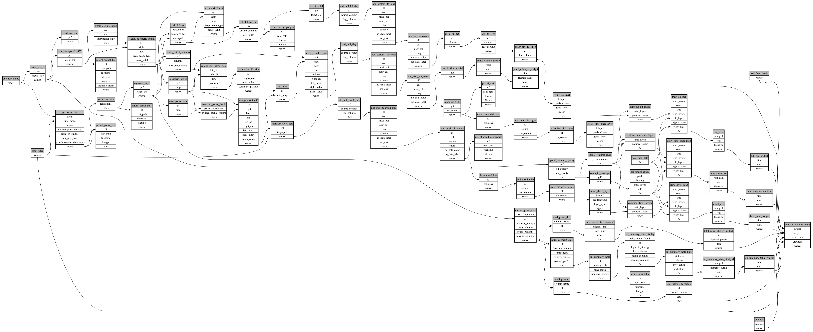

```
# AUTOGENERATED BY ECOSCOPE-WORKFLOWS; see fingerprint in README.md for details

```

```yaml
# fingerprint:
artifacts_sha256_basic: 12611d224eb07b758ecfc1f825c53dd05b52d1aa17cc7ea7530db19308b98ddc
artifacts_sha256_strict: aadd659bad865a9f68a85a632bbb73036315121c8800192f9b41db1feed76e78
installed_requirements:
- channel: https://repo.prefix.dev/ecoscope-workflows/
  name: ecoscope-platform
  version: {version: ==2.25.3}
- channel: https://repo.prefix.dev/ecoscope-workflows-custom/
  name: ecoscope-workflows-ext-custom
  version: {version: ==0.1.0rc14}
- channel: https://repo.prefix.dev/ecoscope-workflows-custom/
  name: ecoscope-workflows-ext-ste
  version: {version: ==0.0.0rc1}
- channel: https://repo.prefix.dev/ecoscope-workflows-custom/
  name: ecoscope-workflows-ext-mep
  version: {version: ==1.0.3}
- channel: conda-forge
  name: pydeck
  version: {version: ==0.9.2}
- channel: conda-forge
  name: opentelemetry-sdk
  version: {version: ==1.45.1}
params_sha256: b0de1b40e044175752b4b6cf5fb7a53bfa518dbae3ee8d8fdec4aa33dfb76b17
spec_sha256: 0d8e2d0a904bf955ccc3026920bb857ce13bc9c03a81b3ef7e74bd1155341da7

```

# ecoscope-workflows-patrol-field-effort-workflow


